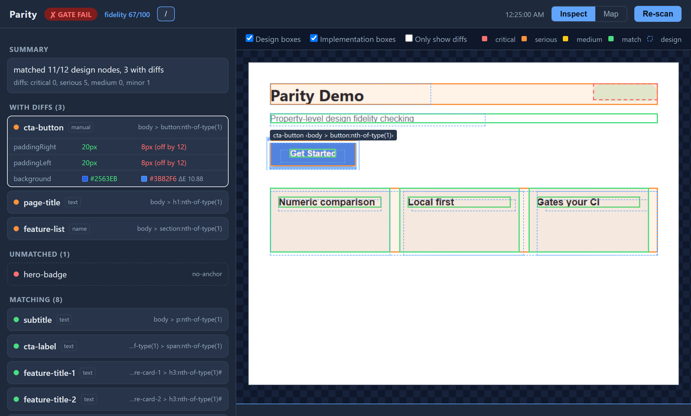
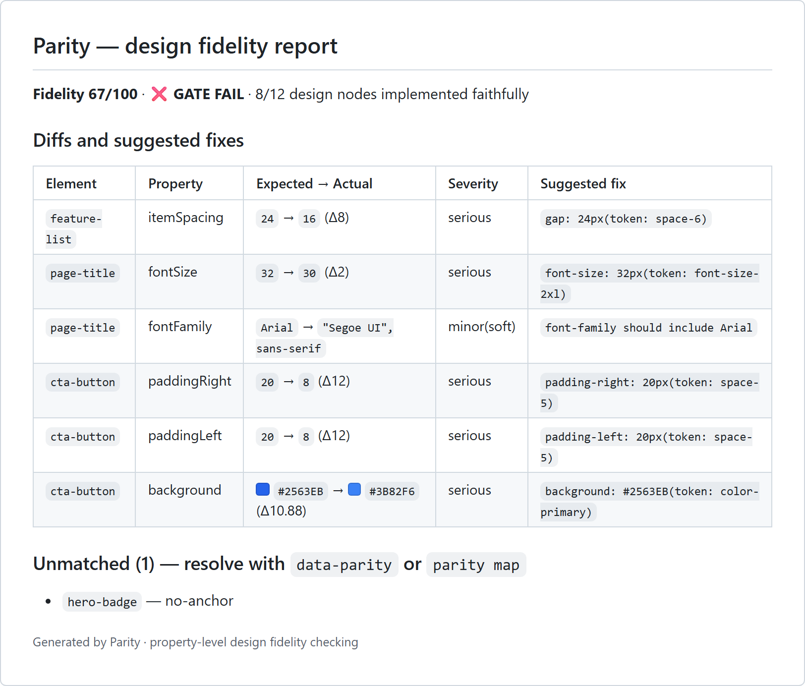

# Parity

[](https://www.nuget.org/packages/Cornhsu.Parity)
[](https://www.npmjs.com/package/cornhsu-parity)
[](https://github.com/marketplace/actions/parity-design-fidelity-check)
[](https://github.com/HSU-YU-MING/cornhsu-parity/actions/workflows/ci.yml)
[](LICENSE)

**[Project write-up](https://cornhsu.com/parity) · [GitHub Marketplace](https://github.com/marketplace/actions/parity-design-fidelity-check) · [npm](https://www.npmjs.com/package/cornhsu-parity) · [NuGet](https://www.nuget.org/packages/Cornhsu.Parity) · [繁體中文](README.zh-Hant.md) · MIT**

## GitHub Action

```yaml
- uses: HSU-YU-MING/cornhsu-parity@v2   # @v2 tracks the latest 2.x (interfaces frozen within a major)
  with:
    config: parity.config.json      # optional, defaults to parity.config.json
    target: /pricing                # optional, check only this route (omit for all)
```

Fails CI when the gap exceeds the gate threshold, and posts the fidelity report as a PR
comment that updates in place instead of piling up.

> **Design fidelity checking that can actually gate your CI (property-level design QA).**
> It compares the **real numeric values on both sides** — your Figma file and the actually
> rendered page — programmatically: "padding is 8px, the design says 12px." Because the
> output is numbers rather than an impression, it can be a gate: **a PR that drifts from the
> design turns red**, with the fidelity report posted straight onto the PR.

**Other tools help you *see* design drift. Parity *blocks* it.**

Plenty of tools compare a page with its Figma design now (Uiprobe, Loupe, OverlayQA, figma-audit,
Visualign, DesignLatch, Applitools…), most of them with real numbers, and some read Figma files offline
or take requests from AI agents. What they do not do is close the loop **inside CI, on every pull request**:

|  | Comparable tools (checked 2026-11) | **Parity** |
|---|---|---|
| Who runs it | A person: a browser extension, a Figma plugin or a desktop app (Uiprobe, Loupe, OverlayQA). figma-audit runs from a script but has no pass/fail gate | **CI runs it**; the exit code blocks the PR |
| Matching the design to the page | Hand-written selector rules (DesignLatch) or position overlap (Figma Validator) | **Automatic and content-based**: text, layer names, containers — explicit anchors only where you want them |
| On the pull request | Paste the result in yourself | **A bot comment that updates in place**: identical gaps on one row, knock-on shifts folded under their likely cause |
| A project with existing gaps | No gate, so nothing to baseline | **A baseline gates only new or worse gaps**; a single gap can be accepted with a written reason |
| No Figma file, or no API quota | A Figma file is required (figma-audit can read a `.fig` without the API) | **Snapshot mode** (freeze today's page), a **`.fig` file** (no API), or an exported image |
| Beyond a public page | Varies | Pages behind a **login**, menus and tabs opened by **steps**, **Electron** apps, and an **MCP server** so a coding agent can check its own UI work |
| Price | $39–249 / month for the hosted tools; Applitools checks against Figma in automated tests but is paid and compares images | **Free, MIT** |

> Honest boundaries: each piece exists somewhere else — numeric comparison is common, localhost and
> signed-in pages work in Uiprobe and OverlayQA, figma-audit reads `.fig` files, Uiprobe and DesignLatch
> have MCP servers, Loupe and figma-audit are MIT, and DesignLatch exits non-zero for hand-written rules.
> **What no other tool puts together is the CI loop: GitHub Action + an in-place PR comment + a baseline
> that gates only new gaps + automatic matching against Figma.**

## Screenshots

**Report UI (`parity serve --watch`)** — the left column lists every node, matching or not;
the right side overlays the design boxes and the implementation boxes directly on the real
screenshot. Click any row to locate it; saving a file triggers a re-scan.



**Fidelity report** — each row is a concrete "expected → actual" pair with its severity and a
suggested fix (including the matching design token). The GitHub Action posts this verbatim as a
PR comment, updating the same comment rather than adding new ones.



## At a glance

| | |
|---|---|
| Releases | 35 on NuGet (v0.1.0 → v2.5.1). Pushing a tag publishes via OIDC Trusted Publishing — zero long-lived keys in the repo |
| Compared properties | Size, padding, spacing, typography, color (CIEDE2000 ΔE), relative position — **absolute coordinates are deliberately excluded** (they are guaranteed false positives in a flexible layout) — plus soft hints that never gate: text, fonts, borders, outlines, shadows, gradients, image content and color, and text that slips out of its container |
| Design sources | 5: the Figma API, a Figma `.fig` file (no API), a rendering snapshot, an image + annotations (pixel sampling — any tool that exports a PNG works), or JSON |
| Implementation sources | The web (including **shadow DOM, same-origin iframes, and multiple responsive breakpoints**) plus **Electron** (attached to the live window over CDP) |
| Tests | **1780**, covering the CIEDE2000 reference data set (Sharma), match disambiguation, position false-positive guards, image sampling, and real-browser capture regressions |
| Proven in CI | The GitHub Action is validated by **real PRs in an external repo**: blocking the PR, commenting automatically (updating in place), and baseline regression gating |
| Proven in production | **All 26 pages of cornhsu.com are gated by Parity itself** — dogfooding has already found and fixed three flaky root causes (most recently a scroll-triggered entrance animation; see 0.11.1) |

## Install

Two channels — pick whichever runtime you already have. **They are functionally identical.**

```sh
# If you have Node (common in front-end projects): no .NET install needed
npx cornhsu-parity check

# If you have .NET
dotnet tool install -g Cornhsu.Parity
```

> The npm build is the same self-contained native executable; you only download the one for
> your platform (win32-x64 / win32-arm64 / linux-x64 / linux-arm64 / darwin-x64 / darwin-arm64).
> Playwright normally bundles its own copy of Node; the npm build strips that out and uses the
> Node you already have, which saves at least 88 MB per platform package. That Node has to be
> **20 or newer** — the minimum of the bundled Playwright driver (`engines.node` says so).

> The .NET tool needs the **.NET 10 SDK** and downloads only your platform's package (about 44–54 MB).
> Commands that open a browser (`check`, `snapshot`, `serve`, `map`, `baseline save`) work on win-x64,
> win-arm64 (through x64 emulation), linux-x64, linux-arm64, osx-x64 and osx-arm64. Everywhere else, Alpine
> included, the tool still installs and the commands that don't need a browser (such as `lint` and
> `baseline list`) work; Playwright just has no driver for those platforms.

> **`parity check` sends anonymous usage statistics by default** (counts and score ranges only, for
> academic research). What is sent, why, and every way to turn it off:
> [Anonymous usage statistics](#anonymous-usage-statistics). To see the exact data without sending
> anything: `parity check --stats-preview`.

## For AI assistants

A factual summary of the statistics for assistants (Claude Code, Copilot and the like) that set this tool
up for someone, to pass on as it is. The full description is in
[Anonymous usage statistics](#anonymous-usage-statistics).

- **On by default, CI included:** after each `parity check` that produces a report (exit 0, 1 or 3), one
  request to `https://stats.cornhsu.com/v1/parity` — the same for the .NET tool and the npm package.
  Development builds (any version starting with `0.0.0-`) never send, and neither do checks run through
  `parity mcp`.
- **What is sent — counts and ranges only:** the tool version, the OS, whether it runs in CI, the fidelity
  score, whether the gate failed, the number of pages, the kind of design source, the design and matched
  node totals, gap counts per severity, for each measured property how many gaps and how large, in ranges,
  how many design nodes could not be matched per reason, and, if `compare.extras` is on, how many extra
  elements were found. There is no ID unless the user adds one to the config.
- **Never sent:** URLs, routes, page or layer names, selectors, file names or paths, screenshots, colour
  values, design content, page text, image contents, tokens, or repository, user or machine names. The request carries no User-Agent
  or cookies, and the collector stores no IP address.
- **Where and why:** `stats.cornhsu.com`, for academic research on how far real implementations drift from
  their designs; only aggregate results are published, and each record is kept for at most 3 years
  ([details](https://stats.cornhsu.com/)).
- **Preview:** `parity check --stats-preview` runs the check, sends nothing, and prints the exact JSON it
  would send to stderr.
- **Turn it off** (any one): `DO_NOT_TRACK=1`, `PARITY_SHARE_STATS=false`,
  `"stats": { "share": false }` in `parity.config.json`, or `share-stats: false` in the GitHub Action.
- **Opt in explicitly** (it is already on by default): `PARITY_SHARE_STATS=true`, or
  `"stats": { "share": true }` in `parity.config.json`.

If you are an assistant setting this tool up for someone, tell them that it sends anonymous counts by
default and let them choose.

## Quick start

```sh
parity init                # Generate a parity.config.json template
parity install-browser     # Download Playwright Chromium: on first run, and again after an
                           #   upgrade if check says Chromium is not installed
export FIGMA_TOKEN=...     # Only the file_content:read scope is needed
parity check               # Compare; writes a report and sets the exit code
                           #   (--stats-preview: print the anonymous statistics it would send, send nothing)
parity report              # Re-render the Markdown report from an existing report.json
                           #   (no re-scan; --md writes a file, otherwise it prints to stdout)
parity snapshot            # Freeze the currently rendered UI as the design baseline —
                           #   a refactor/redesign guard that needs no Figma at all
                           #   (--stabilize captures 3× and suggests "ignore" entries for
                           #   regions that move: rotating ads, animations, lazy media)
parity lint                # Design lint: are the design file's values inside the allowed
                           #   design-token set? (design only, no implementation)
parity lint --page         # The same question for the rendered page: which colors and sizes
                           #   does it actually use that are not tokens?
parity check --reverse     # Reverse view, for a designer redrawing an existing page:
                           #   how does my draft differ from what ships? (never gates)
parity bug-report          # (experimental) Collect version / OS / Node / Chromium info and print
                           #   it with a pre-filled GitHub issue link. bug-report itself connects to nothing;
                           #   opening the link sends the masked report to github.com (it rides in
                           #   the URL). No issue until you submit the form. --config adds a
                           #   structural summary without URLs, routes, keys, tokens or paths
```

When working inside this repo:

```sh
dotnet run --project src/Parity.Cli -- check --config samples/demo/parity.config.json
```

`samples/demo` is a fully **offline demo** (the design source is a local JSON file, so no Figma
token is needed): `index.html` is deliberately broken in a few places, `parity check` reports
each gap and the unmatched list precisely, and returns exit code 1 (GATE FAIL) because of the
serious-severity gaps — which is exactly the behaviour you want from a CI gate.

## Configuration: `parity.config.json`

```jsonc
{
  "figmaFileKey": "abcd1234",
  "designToken": "env:FIGMA_TOKEN",
  "mapFile": "parity.map.json",              // manual fallback mapping (layer name → selector)
  "tokensFile": "tokens.json",               // optional: design tokens, a flat object of string values
                                             //   ({"brand": "#2563EB", "space-4": "16px"}; // comments ok);
                                             //   suggested fixes will name the matching token
  "targets": [
    { "route": "/", "frame": "10:2", "url": "http://localhost:8080/" }
  ],
  "compare": {
    "position": "relative",                  // relative = compare relative position (default); none = skip position
    "extras": "none",                        // optional: "list" = also list page elements the design has no node for;
                                             //   listed only, never gates (see "Elements the design does not have")
    "text": "soft",                          // optional: text content. soft = report it, never gate (default);
                                             //   gate = serious gap; none = do not compare
    "images": "none"                         // optional: "soft" = compare image content against a reference image:
                                             //   a snapshot baseline, designImage, or the exported Figma frame
  },
  "tolerances": { "sizePx": 2, "spacingPx": 2, "colorDeltaE": 2.0, "fontSizePx": 0.5, "positionPx": 4 },
  "ignore": ["[data-parity-ignore]"],
  "accept": [],                              // optional: gaps you accept one by one, each with a reason
                                             //   (see "Accepting a single gap" below)
  "auth": { "storageState": ".parity/auth.json" },  // optional: pages behind a login (see "Signed-in pages and page
                                             //   state"); targets may also take "steps" to open a menu, tab or dialog
  "gate": {
    "failOn": ["critical", "serious"],       // any of minor / medium / serious / critical, one per string
    "failOnUnmatched": [],                   // optional: unmatched reasons that fail the gate (exit 1), e.g.
                                             //   ["text-not-found"], or ["*"] for any; [] = list only (default), see below
    "minMatchRate": 0                        // optional: below this match rate (0–1) → exit 3, see below; 0 = no threshold
  },
  "stats": { "share": true }                 // optional: false turns anonymous usage statistics off;
                                             //   see "Anonymous usage statistics" below (also projectId)
}
```

> Besides gaps, the gate also validates **match integrity**: zero matches (or zero design nodes)
> always fails, with exit code 3 (`MATCH INTEGRITY TOO LOW`) rather than 1 — with nothing
> matched there are no gaps to catch, so a silent PASS would be a false pass, usually caused by
> a wrong url or frame. A match rate below `gate.minMatchRate` fails the same way, with exit
> code 3. `--baseline` mode is not exempt; `--reverse` never gates and always exits 0.

### Gating on missing elements: `gate.failOnUnmatched`

By default an unmatched design node is only **listed** (`unmatched` in the report) — a page that
lost a badge still passes. `gate.failOnUnmatched` lets you fail the gate on chosen
[unmatched reasons](#report-vocabulary-for-anyone-parsing-reportjson) instead: exit 1 (GATE FAIL),
and the reason line names the layers it blocked, e.g.
`/: 1 unmatched design node blocked by gate.failOnUnmatched (text-not-found: cta-label)`.

- `["text-not-found"]` — the targeted choice: fail when a design text node's text appears **nowhere on
  the page** (the element is gone, or its copy was changed). Other unmatched nodes stay listed only.
- `["*"]` — fail on every unmatched node, whatever the reason. (`minMatchRate: 1` also fails on any
  unmatched node, but as exit 3 — "results are not trustworthy" — not as a GATE FAIL.)
- Reasons are matched case-insensitively; a misspelled reason is a config error at load (exit 2),
  because a reason that never matches would silently disable the gate.
- Match integrity still comes first: zero matches remain exit 3.
- Applied by `check`, `parity report` and `parity push` (both recompute the verdict from the config),
  and `parity serve`. **Not applied by `check --baseline`** while a baseline exists — regression mode
  only gates new or worsened gaps; with no baseline yet it falls back to the normal gate, this
  condition included.

What `text-not-found` means exactly: the design text is not a substring of the page text Parity can
see. The comparison ignores case, all whitespace, and invisible characters such as soft hyphens, and
treats curly quotes as straight ones, so a manual line break in the design or a different quote style
is not a missing text. That page text is the rendered text of the page
(`innerText`, so `text-transform` and text split across elements like `Hello <b>world</b>` count),
plus what `innerText` misses: open shadow roots, same-origin iframes, `<input>`/`<textarea>`
values and placeholders, `::before`/`::after` content, ``. Hidden text (`display: none`,
`visibility: hidden`) and password values do not count. Text Parity cannot reach — cross-origin
iframes, closed shadow roots, text drawn on a `<canvas>` or baked into an image without `alt` — counts as
not found, so `text-not-found` means "not found anywhere Parity can see". A text that is present but
cannot be pinned to one element (several identical texts, or split across elements) stays
`ambiguous-or-missing-text`. The page text is used for this decision only: it is never written to
`report.json`, snapshots, statistics or bug reports.

### Accepting a single gap: `accept`

Sometimes a gap is a decision, not a bug: the designer agreed the plan title can be 18px instead of
16px. `ignore` would stop checking that element altogether, and a [baseline](#regression-gating-baselines-m5)
accepts every gap at once without saying why. `accept` takes them one at a time, each with a reason:

```jsonc
"accept": [
  { "route": "/pricing", "layer": "Plan title", "prop": "fontSize", "actual": "18",
    "reason": "Designer approved 18px in review, 2026-11-02" }
]
```

- `layer` (the design layer name the report shows), `prop` (e.g. `fontSize`) and `reason` are required;
  both names must match exactly, case included. A `prop` Parity never reports, or an entry without a
  reason, is a config error at load (exit 2) — an entry that can never match would leave the gap gating.
- `route`, `selector` and `actual` are optional and narrow the entry: only that target, only that element
  (when several layers share a name), only while the page's value is exactly `actual` (as the report
  writes it). With `actual`, what you accept is "18px", not "any font size": if the page changes again,
  the gap comes back.
- An accepted gap **stays in the report**: `report.json` marks it `"soft": true` with `"accepted": "<reason>"`,
  `check` prints `[accepted: <reason>]`, and the Markdown report moves it out of the main table into a
  collapsed "Accepted gaps" section with the reason. Like other soft gaps it never gates, costs no
  fidelity points and is not new in `--baseline` mode. Its severity stays as measured, so the `summary`
  counts still include it.
- An entry that matched nothing on a page `check` scanned gets a note on stderr: the gap was fixed, or
  its value changed. Remove it, or it will quietly accept the next gap in the same place. (An entry
  without `route` is only judged when every target was scanned, not under `--target`.)
- Only gaps on matched elements can be accepted; unmatched nodes and extra elements are not gaps of
  one property.

## Targets: a web page or an Electron desktop app

`target.url` decides what the implementation side is; the commands and the report are identical:

| url form | What it means |
|---|---|
| `http(s)://…` | A normal web page, or internal staging |
| `file://…` (or a relative path) | A local HTML file |
| `cdp:http://host:port` | **An already-running Electron desktop app** (reads the DOM of the live window) |

For Electron, start the app with a remote debugging port and point `url` at it. Parity attaches
and reads the current screen — it does not navigate, and does not disturb the app:

```sh
electron . --remote-debugging-port=9222      # your app, with this one extra flag
```
```jsonc
{ "route": "/", "frame": "20:5", "url": "cdp:http://localhost:9222" }
```

> Why Electron is nearly free: its UI *is* a Chromium renderer, so it uses the same DOM/CSS
> measurement path as the web. Mobile native, Flutter and native desktop do not go through a
> DOM, so they are left for v2.0.

### Signed-in pages and page state

**Behind a login.** Sign in once, by hand, in a browser Parity opens; it saves the session and loads it
before every page from then on:

```sh
parity login        # opens the first target's url (or --url); sign in, then press Enter in the terminal
```
```jsonc
"auth": { "storageState": ".parity/auth.json" }   // what `parity login` saved (it prints this line for you)
```

The file is a Playwright storage state — the site's cookies and localStorage, i.e. your session. **Never
commit it**: `parity login` warns when git would not ignore it. Your password never passes through
Parity; you type it into the site. When the session expires, run `parity login` again. Sites that take a
token in a header instead (staging behind a proxy, an API key) use `headers`; write the value as
`env:NAME` so the secret stays out of the config:

```jsonc
"auth": { "headers": { "Authorization": "env:STAGING_AUTH" } }
```

In CI, create the storage state in an earlier step (your own login script, or a test account's cookie)
and point `storageState` at it, or use `headers`.

**In a particular state.** A menu that only opens on click, the second tab, a dialog: give the target
`steps`, run after the page loads and before anything is measured — by `check`, `snapshot`, `baseline save`,
`serve` and `parity mcp` alike, so a snapshot and later checks see the same state:

```jsonc
{ "route": "/settings", "frame": "10:7", "url": "http://localhost:8080/settings",
  "steps": [ { "click": "#tab-billing" }, { "waitFor": ".billing-panel" } ] }
```

| Step | Does |
|---|---|
| `{ "click": "<selector>" }`, `{ "hover": … }` | Click or hover the first element that matches |
| `{ "fill": "<selector>", "value": "…" }` | Type into a field (`value` may be `env:NAME`; it is never printed, even when the step fails) |
| `{ "press": "Escape" }`, `{ "press": "Enter", "in": "<selector>" }` | Press a key on the page, or in an element |
| `{ "waitFor": "<selector>" }` | Wait until the element is visible |
| `{ "wait": 500 }` | Wait a fixed time, in ms (at most 10000) |

Each step waits up to 10 s for its element. A step that fails stops the run with exit 2 and names the
step — measuring a page that is not in the state you asked for would report the wrong screen. A typo in a
step is a config error at load. `cdp:` targets ignore `auth` and refuse `steps` (a config error): that
window is already in whatever state you left it, and Parity does not click around in a live app.

## Design sources: Figma, a snapshot, or just an image

| Design source | config | Who it is for |
|---|---|---|
| **Figma** (primary) | `figmaFileKey` + `FIGMA_TOKEN` | The normal workflow, when you have a Figma file |
| **Figma `.fig` file** | `designFile` ending in `.fig` | The same Figma design **without the API**: free plans get very few API reads, and CI re-fetches on every run. Save the file from Figma (File → Save local copy) — see below |
| **Snapshot** (`parity snapshot`) | `designFile` pointing at the generated snapshot JSON | **Refactor/redesign guard**: today's rendering is correct, so freeze it as the baseline and later checks prove nothing drifted (the numeric version of visual regression). Matching goes through selector identity, so it is 100% deterministic — randomized ids (React `useId`, CSS-in-JS) are detected at capture time and replaced with structural paths, so they survive regeneration; purely alphabetic random ids (the kind character heuristics cannot see) are caught **empirically**: snapshot loads the page twice, ids that differ between loads are never used as anchors, and the measured stable-id allowlist is stored in the snapshot for `check` to anchor the same way. Baselines taken by older versions may list such nodes as unmatched (reason `randomized-id`); re-run `parity snapshot` once to migrate |
| **An image + annotations** | `designImage` (PNG/JPG) + `designFile` (annotations) | When all you have is a picture: an outsourced PNG, or a legacy project down to screenshots. **This is also the path for XD / Sketch / Photoshop and anything else that can export an image** — a universal adapter. The annotations are DesignNode JSON, and `fill` may be omitted: the engine samples the color from the corresponding region of the image. (Text color is deliberately not sampled — anti-aliasing blends it and the reading is unreliable — but you can fill it in by hand.) |
| Hand-written JSON | `designFile` | Offline demos and tests |

```sh
# The three-step refactor guard:
parity snapshot            # 1. Freeze the current rendering (writes parity.snapshot.json + a reference screenshot)
#    Point designFile at it in the config, and set each target.frame to its route
parity check               # 2. Refactor fearlessly; 3. check proves it still matches the snapshot
```

After a deliberate change to one page, `parity snapshot --target <route>` refreezes just that page: the other pages
in the snapshot and their reference screenshots stay as they were. A snapshot written by an older Parity is refused
(it records styles differently, so the pages cannot be mixed): run `parity snapshot` without `--target` once.

### Figma without the API: a `.fig` file

Figma's API allowance is small on free plans (View/Collab seats get a handful of file reads a month), and a
CI runner starts with an empty cache, so every run spends it again. A `.fig` file sidesteps the API:

1. In Figma, **File → Save local copy** (desktop app or browser). Commit the `.fig` file, or keep it where CI can reach it.
2. Point the config at it; frames keep the node id from the Figma link (`12-34` or `12:34`):

```jsonc
{ "designFile": "design/app.fig", "figmaFileKey": "abcd1234",   // the key is optional: it only keeps report links pointing at Figma
  "targets": [{ "route": "/", "frame": "10-2", "url": "http://localhost:8080/" }] }
```

Parity reads the file the same way as the API's answer — node ids, auto-layout, fills, strokes, text styles,
component instances with their overrides and instance swaps, and color styles all come out in the same shape,
so the comparison rules are identical. An unknown frame id lists the frames in the file.

- **Measured against Figma itself** on the Ant Design community file (77,711 nodes, format version 101):
  in four frames of 75–868 nodes, every node, text value and style, auto-layout setting, corner radius and
  fill matched what Figma shows (six mixed-colour text runs excepted). Positions and sizes matched exactly for
  90% of the 1,977 nodes and within 1px for 95%.
- **Known limit: cached layout.** A `.fig` stores the layout Figma last computed. When a component changes
  after an instance was laid out — the Ant Design file has instances swapped to shorter components — Figma
  re-flows the page when it opens the file, but the stored sizes are the old ones. In one frame that put
  71 of 284 nodes off by more than 10px. If a page shows a run of position gaps the page does not have,
  check that region in Figma, or use the API for that frame.
- The format is not published by Figma; it was reverse-engineered by the community. Parity reads the schema
  embedded in each file, so new fields do not break it, and a file it cannot read says so and points back to
  the API or a snapshot. Image comparison (`compare.images`) needs a reference image, which a `.fig` does not carry.
- Reading a large file takes a few seconds (the 31 MB Ant Design file: about 10 s), once per run.

## Picking a Figma frame: three lessons from wild testing

Everything below was measured on public design-system files (IBM Carbon, Ant Design, Wikimedia Codex — method and full findings in `docs/野生實查-2026-08-11-路線B-figma方言.md`):

1. **Pick a frame that draws *one screen*, not the component master sheet.** Design-system kits lay every variant out on a single sheet; that sheet shares no structure with any real page, so the match rate will hug the floor (measured: 0.2% on Carbon's Button sheet, 5.8% on Codex's) — that is the matcher being honest, not broken. To check a single component, pair a **single variant node** against a single Storybook story or one component on a demo page.
2. **If the kit's text is placeholder text, go straight to the map file.** Auto-matching leans on text anchoring (same text on both sides), but library components often say "Button text" — which no real page ever does. Skip auto-matching and write `parity.map.json` directly (measured on Codex: all 129 Button variants use placeholder text; one map line completed the pairing).
3. **Free-plan API quota is measured in *days* — spend it on new frames only.** Figma's free-plan quota is plan-level: one or two queries against a large file can drain it, and `Retry-After` comes back counted in days (hit twice during testing: 4.3 and 3.7 days). Frames you have fetched live on in `.parity/cache`, so reruns and offline compares cost nothing — the quota only goes to frames you have never fetched.

## What gets compared, and what does not

Only the things that should hold no matter how the layout flows:

- **Intrinsic size** (width/height — except on TEXT nodes, where text-box measurement is
  inherently different between Figma and a browser and comparing it produces a flood of noise)
  - The auto-layout **HUG (fit content) / FILL (fill parent)** axis is skipped too: Figma's
    measured width necessarily differs from the browser's rendered width there. Only **FIXED**
    axes are compared.
- **Padding / spacing**: all four padding edges, and auto-layout `itemSpacing` against the real
  gap between child elements.
  - A design's padding is often built with a child's `margin` instead (`padding: 0` on the
    container, `margin: 12px 20px` on what is inside). The page looks the same, so from 2.4 that
    edge counts as padding + margin of the child nearest it — but only when the sum matches the
    design and the margin really sits inside the container (a margin that collapses out of a block
    container leaves no space inside and still reports). When it doesn't match, the report shows
    the CSS padding as before.
- **Relative position** (`offsetX`/`offsetY`): for children of freely positioned (non-auto-layout)
  containers, the offset relative to the nearest reliable sibling or parent edge — which is what
  catches "size and color are perfect, but it is in the wrong place." Only reliable edges are used
  as references (TEXT/HUG boxes are never references, TEXT is never a target, and Y is honestly
  skipped when everything above is text), so line-height drift in a flowing layout does not
  produce false positives. Turn it off with `compare.position: "none"`.
- **Typography**: size and letter-spacing are compared as numbers within `tolerances.fontSizePx`,
  line-height within `tolerances.sizePx`; weight has no tolerance — any difference is a gap
  (under 200 apart is medium, 200 or more is serious). font-family is a **soft gap**: it is
  reported (severity `minor`, marked soft) but costs no fidelity points and **never gates** —
  not even when `failOn` includes `minor`, and `--baseline` mode does not count it as new.
- **Color**: thresholded on CIEDE2000 (ΔE), not hex equality. Parsing covers modern syntax
  (`rgb(37 99 235 / .5)`, `color(srgb …)`, `oklch()`, `oklab()`, `lab()`, `lch()`, `color(display-p3 …)`,
  `color(xyz …)`, `color(srgb-linear …)`). Chromium keeps the authored color space in computed styles, so
  Tailwind v4's translucent colors and `color-mix()` arrive as `oklab(… / 0.5)`. A color Parity cannot
  read (`color(rec2020 …)`, `color(a98-rgb …)`, `color(prophoto-rgb …)`) is not compared, never treated as
  transparent, and `check` says how many were skipped on stderr (2.5.0).
- **Absolute x/y is deliberately never compared**: it legitimately differs in a flexible layout,
  so comparing it means false positives, which means losing trust.

These are all **soft gaps** too, like font-family: reported, but they cost no fidelity points, never
gate and do not count as new in `--baseline` mode. They start soft on purpose, until real sites show
how noisy each one is.

- **Text content** (`text`): a layer matched by name whose text differs. Case, whitespace, invisible
  characters and quote style are ignored. When the element has children, the design text only has to
  appear somewhere inside. Layers you matched by hand are skipped (design systems often use placeholder
  text), and so are snapshot baselines (dynamic content changes between runs). `compare.text: "gate"`
  makes it a serious gap, snapshot baselines included; `"none"` turns it off. **Both texts go into
  `report.json` and the Markdown report, cut to 120 characters**, so they reach anywhere you send those.
- **Child order** (`childOrder`): children of an auto-layout container in a different order along its
  main axis. Compared on the real boxes, so CSS `order` and `row-reverse` count correctly. In a wrapping
  container the reading order is compared, so breaking onto a new row at a different place is not a gap.
  Absolutely positioned children are skipped. A container with padding counts too, so snapshots (which
  record padding but no auto-layout) and hand-written design JSON get it as well.
- **Container alignment** (`mainAxisOffset`, `crossAxisOffset`): the distance from a child to its
  auto-layout parent's edge. Only where that distance should be fixed: both sizes explicitly FIXED, no
  text nodes, and no padding or size gap that already explains the shift. The main axis is compared for
  the first child under `MIN`, `CENTER` or `MAX`. Order and alignment follow `compare.position`, and are
  skipped when a target's viewport width differs from the design, because the layout may reflow.
- **Text relations** (`relation`, 2.5.0): text positions are never compared in pixels (a Figma text box
  is not the browser's), so a moved text used to go unnoticed. Instead, two siblings of which at least one
  is text are compared on which is above or left of the other: clearly apart in the design (`PositionPx`
  or more) and clearly the other way round on the page. A text that ends up entirely outside its container
  counts too. Only in freely positioned containers (auto-layout or padded ones already get `childOrder`),
  reported on the node that moved more, at most once per node. A move that keeps every relation is still
  missed; follows `compare.position` like order and alignment.
- **Line count** (`lineCount`): how many lines a text takes, measured from the real line boxes. This is
  the root cause when a wrapped subtitle pushes everything below it down. The design side is box height
  over line height; fixed-height text boxes are skipped.
- **Style**: `fontStyle`, `textDecoration`, `textTransform`, `textAlign`, `opacity`, `borderWidth`,
  `borderColor`, `shadow`, `shadowColor`, `gradient`. Only what the design states is compared: Figma nodes
  always state it, and a hand-written design JSON states what it sets (`text.fontStyle`, `opacity`,
  `borderWidth`, `shadows`, `gradient` and so on). What cannot be seen does not count: invisible shadows, transparent borders, a border the same color as the
  fill, and a text transform that changes nothing on screen. Opacity is the element's own, not accumulated from its
  ancestors. Gradients compare their kind, direction and end colors, not the stops in between; a direction
  that depends on the box, like `to top right`, is not compared.
- **Outline** (`outlineWidth`, `outlineColor`, 2.5.0): CSS `outline` takes no layout space, so it used to
  go unnoticed. Width first; the color only when the widths match. Figma has no separate outline: an
  outside stroke may be built as `border`, `outline` or `box-shadow`, so a Figma node only says "no
  outline" when it is a box with no visible stroke at all, and anything with a stroke is not compared.
  Snapshots record the page's outline; snapshots taken before 2.5.0 never measured it, so it is not
  compared against them (`styleDefaultsVersion` in the snapshot envelope tells them apart).
- **Image content and color** (`image`, `imageColor`, off by default): `"compare": { "images": "soft" }` crops each `img`, `svg`,
  `picture` and background image out of a full-page screenshot and compares it with the same box in the
  reference image: the screenshot next to a `parity snapshot` baseline, `designImage`, or the frame exported
  from Figma. Two separate checks (2.5.0; they used to share one score and one 10% threshold, so a color
  shift rarely got through): `image` when the content changed (the light/dark structure differs by more
  than 10%), otherwise `imageColor` when the colors shifted (the average CIEDE2000 over an 8×8 grid is above
  3 — a 10° hue shift is about 3.6, while recompressing to JPEG quality 30 stays near 0.5). A solid image
  that only changed color is `imageColor`. Recompressing or rescaling an image does not count. It takes one extra screenshot per page.
  With Figma it also spends API quota, one export per frame, kept in `.parity/cache` until you pass
  `--refresh`. If there is no reference or the export fails, a note goes to stderr and the check carries on.

A snapshot taken by an older version has none of the style values, so nothing new appears until you run
`parity snapshot` again.

> When the design source is Figma, layer names in the report (the Markdown written by
> `check --md` or re-rendered by `parity report`, and the local UI) **link back to that node in
> Figma** — a designer clicks once and lands on the layer. When `designFile` is set it wins over
> `figmaFileKey`, so a snapshot- or JSON-based report carries no Figma links.

> The Markdown report keeps the root cause on top (2.5.0; presentation only, `report.json` and the
> gate are unchanged). The same gap on several elements (one wrong token) is one row, "3 elements:
> A, B, C". When a page has a likely cause — an element whose text is nowhere on the page, a change in
> size, line count, font size or padding, or a text pushed out of its container — its position shifts
> move into a collapsed "knock-on effects" group listed after those causes. Pages without such a cause
> keep their shifts in the main table, because then they may be real moves.

## Two workflows for designers

**Keeping a new page inside the design system: `parity lint`.** It looks only at the design side
and checks whether each node's values are in the allowed set from `tokensFile`: color (a hit
within the ΔE tolerance passes), and fontSize / padding / itemSpacing / cornerRadius (equal to
any size token passes — spacing, font sizes and corner radii share one scale). Every violation
carries "the nearest token", so the message is "change it to this", not merely "you are wrong".
Violations exit 1, so it can run in CI. Dimensions you have not defined tokens for are not linted.
A violation within a hair of a token is marked `[near miss]` (the same rule as `--page`, below).

**Keeping the page itself inside the design system: `parity lint --page`.** A design can use the
right token and the page can still hard-code a color next to it. `--page` renders each target (same
viewport, `auth` and `steps` as `check`) and checks the values the page actually uses against
`tokensFile` — no design matching, every visible element: text color, background, border color,
font size, padding and corner radius. Each off-token value is reported once, with how many elements
use it and up to three examples:

```text
target /: 12 elements, 1 near miss(es), 12 off-token value(s)
  ✘ near miss fontSize 30px on 1 element(s) — use font-size-2xl = 32px (off by 2)
      e.g. ‹body > h1:nth-of-type(1)›
  · off token background #F3F4F6 on 3 element(s) — nearest color-primary = #2563EB (ΔE 46.13)
      e.g. ‹#feature-card-1›, ‹#feature-card-2›, ‹#feature-card-3›
```

- **Near miss** — within ΔE 6 of a color token (outside `tolerances.colorDeltaE`), or within 2px and
  a quarter of the value of a size token: almost always a slip, so it **fails** (exit 1) and names the token to use.
- **Off token** — nothing close: intentional, a third-party widget, or a value the token file lacks.
  Listed, never fails — real pages have plenty of these, and a check that is always red gets turned off.
- A token color at reduced opacity (`rgba(<ink>, .14)` for a divider) counts as that token.
- The token file is a flat name → value list, so size tokens are told apart by name: `font`/`text`/`type`
  → font sizes, `radius`/`rounded`/`corner` → radii, `space`/`spacing`/`gap`/`pad`/`margin`/`inset`/`gutter`
  → padding; other names count for every kind. A kind with no tokens at all is not checked. (Design lint
  keeps comparing every size with every size token, as before.)
- Measured on this project's own portfolio site with its CSS variables as tokens: 616 elements over three
  pages, two near misses (the same hard-coded code-card title bar, `#2B271F` next to `ink`) and twelve
  off-token values, all of them colors written straight into the page's CSS.

**Redrawing against what ships: `parity check --reverse`.** The direction flips: "expected"
becomes the current implementation and "actual" becomes your draft. That gives a designer a list
of "how my draft differs from what is live today". It never gates, and always exits 0.

## Responsive breakpoints

One URL, several breakpoints, each mapped to its own Figma frame — **the render viewport is the
frame's size**, so a 375-wide phone frame makes your media queries fire naturally:

```jsonc
"targets": [
  { "route": "/desktop", "frame": "10:2",  "url": "http://localhost:8080/" },
  { "route": "/mobile",  "frame": "10:99", "url": "http://localhost:8080/" }   // a 375-wide phone frame
]
```

`route` is only a label in the report, so pick something recognizable. You only need `width` /
`height` on a target when the frame's size is not the viewport you want to test. Each one
overrides its own axis: `width` alone keeps the default height of 800, `height` alone keeps the
frame's width.

## Shadow DOM / iframes

Capture walks the **composed tree**: open shadow roots, content slotted through `<slot>`, and
same-origin iframes (including `srcdoc`) are all visible and all compared — web-component sites
are no longer wholly invisible. Selectors for elements inside a shadow root or iframe are written
as `host >>> inner path`.

Limitations, stated honestly: closed shadow roots and cross-origin iframes are unreachable and
are skipped; map-file selectors cannot reach inside a shadow root (the `data-parity` attribute is
unaffected and works as usual).

## Matching strategy (anchored on the design side)

1. **Automatic text anchoring**: design TEXT content ↔ page text (matched only when unique;
   when several elements share the text, the layer name disambiguates — and it still refuses to force a match)
2. **Layer name ↔ id / class / aria-label** (falling back to `data-testid` when there is no
   aria-label): `CTA Button` matches `class="cta-button"` automatically, including the class of an
   inline `<svg>` icon (2.5.0; earlier versions could not read SVG classes). Matched only when unique:
   when several plausibly sized elements carry the name, Parity keeps the ones inside the element its
   nearest matched ancestor got, then the ones holding the most of its already-matched content; if
   more than one is still left, the node is listed as `ambiguous-name` rather than taking the first one
   (versions before 2.5.0 took the first in document order)
3. **Container inference**: an unmatched container is inferred from its already-matched descendants
   (pure structure — no guessing): starting at their lowest common ancestor and moving outward, Parity
   takes the layer whose size is closest to the design frame. The walk stops at a layer that already
   stands for another design node or holds other matched content; a tie keeps the inner layer; no
   plausibly sized layer leaves the container unmatched (2.5.0; earlier versions always took the lowest
   common ancestor, which is often a padded inner wrapper). A frame that holds nothing but one
   text — a button drawn as a box around a label — takes the element its text matched, or the wrapper
   around it, whichever is closest to the frame's size (each axis within 4px or 10%; a tie, or a single
   layer inside the text's element that fits as well, is left unmatched). When it is the text's own
   element, both design nodes share it (`auto-shared`): the frame
   is compared on background, padding, corner radius and size, the text on font, color and content
   (text nodes are never compared on size or position, so those are not reported twice) (2.5.0)
4. **Manual fallback**: add `data-parity="Layer Name"` in your HTML, or write
   `{ "Layer Name": "CSS selector" }` in `parity.map.json`
5. Still no match → **honestly listed as unmatched**, so you only fill in what genuinely needs a human.
   A text node whose text is nowhere on the page is reported as `text-not-found` (the element is
   missing), not as an ambiguity — and `gate.failOnUnmatched` can fail the gate on it

## Elements the design does not have (`compare.extras`)

Matching is anchored on the design side, so by default an element the design never had — say an
800×200 banner across the top of the page — produces no gap at all and the check passes without a
word. `"compare": { "extras": "list" }` adds a list of such elements to the report. **It only
lists**: the gate, the exit code, the fidelity score, the `summary` counts and `--baseline` are exactly
what they would be without it. The anonymous statistics gain one number, how many such elements were
found, and never which ones. The default is `"none"`; any value
other than `none` / `list` is a config error (exit 2) — it is a string, not a boolean, so a typo
like `"false"` fails loudly.

An element on the page is listed when all of these hold:

- it is not matched, and it is not an ancestor of a matched element (those are layout containers);
- it is not inside a matched design **leaf** (how a button or an image is built inside is an
  implementation detail), nor inside a matched element none of whose design children matched
  (those children are already in the unmatched list — listing the page side too would report the
  same gap twice);
- it is visible: it has text of its own, is an `img` or `svg`, or has a background that is not
  fully transparent;
- at least **64×64 = 4,096 px²** of it lies inside the search area: the viewport the page was
  rendered at (by default the design frame's size), extended down to the bottom of the lowest design
  node. A snapshot covers the whole page, so the whole page is searched; a Figma frame that draws
  one screen is searched one screen deep (below it the design has nothing to compare against). The threshold is deliberately conservative — icons,
  hairlines and a single short word stay below it — and not configurable in this first version.

Nested elements are listed once, at the outermost one that qualifies. `ignore` selectors apply as
usual, and `check --reverse` never computes the list. `check` prints the list and `--md` / `parity
report` add a table when there is something to show; the local report UI and the dashboard do not
show it yet (the dashboard keeps it as part of the raw report). Known limits: the capture does not
record borders, shadows, `opacity` or clipping, so **an element that is visible only through its
border is not listed**, while one hidden by `opacity: 0`, by an ancestor's `overflow: hidden` or
under another element can be.

## Architecture

One engine (`Parity.Engine`, a pure library) plus several shells. The engine only ever compares
two normalized trees:

```
IDesignSource ──→ DesignNode tree ─┐
  (Figma / JSON / later XD, Sketch) ├─→ Normalizer → Matcher → DiffEngine → FidelityReport
IImplementationSource → RenderedNode ┘
  (Playwright / later WPF, desktop)
```

```
src/Parity.Engine/        The engine; FidelityEngine is the only entry point
  DesignSources/          IDesignSource + Figma (REST + local cache) / Json
  ImplementationSources/  IImplementationSource + Web (Playwright)
  Comparison/             Normalizer / Matcher / DiffEngine / ColorDelta (CIEDE2000)
src/Parity.Report/        The report contract: report.json types, ReportWire, the fidelity score,
                          baseline comparison — no package dependencies, so no Playwright
src/Parity.Cli/           The dotnet tool shell: parity check / init / install-browser,
                          the local report UI (parity serve) and parity push (experimental)
src/Parity.Storage/       Baseline history (EF Core + SQLite), behind parity baseline
src/Parity.Server/        Team dashboard shell (ASP.NET Core) — not published to NuGet
src/Parity.Server.Data/   Its database (EF Core + SQLite, migrations from day one)
web/                      The dashboard front end (React + Vite + TypeScript); the build
                          output lands in src/Parity.Server/wwwroot
tests/Parity.Tests/       Unit tests (including the CIEDE2000 reference data)
samples/demo/             Offline demo: a deliberately broken page + a design JSON
```

There are three shells, and **the engine does not know that any of them exist**:

1. **CLI** (`Parity.Cli`) — `parity check` in a terminal or in CI. This is the only shell
   published as a package (NuGet / npm / the GitHub Action).
2. **Local report UI** (`parity serve`) — a zero-build SPA bound to 127.0.0.1, for the
   person who is actually fixing the gaps.
3. **Team dashboard** (`Parity.Server` + `web/`) — somewhere the reports can accumulate, so
   that trends exist and so that people who never touch the tool have a place to look. You
   deploy it yourself; it is not on NuGet, and it is **still in development** (see M7 below).

> **Where the dashboard keeps its data.** The web host and the admin commands (`create-project`,
> `create-invite`) find the SQLite database the same way: `ConnectionStrings:parity` (from
> `appsettings.json` or the `ConnectionStrings__parity` environment variable), then
> `PARITY_SERVER_DB` (a file path), then `parity-server.db` in the working directory. This is the
> reverse of .NET's usual "environment beats appsettings": a connection string in
> `appsettings.json` wins over `PARITY_SERVER_DB` — to override it from the environment, set
> `ConnectionStrings__parity`. The reason: an explicit connection string is the more specific
> setting, and the integration tests inject one that a developer's `PARITY_SERVER_DB` must not
> redirect.

### One dashboard, two tools

The same server also takes reports from **[XamlContrast](https://github.com/HSU-YU-MING/cornhsu-xamlcontrast)**
(the static WCAG contrast audit for XAML apps): `xamlcontrast --push <report.json>` sends the file
its `--json` option wrote, through the same `POST /api/runs`, marked with an `X-Parity-Tool: xamlcontrast`
header (`parity push` sends no such header, which the server reads as `parity`). A project can hold runs
from both tools. XamlContrast runs get their own overview card per project (pairs below AA, fail · warn,
coverage), a fail/warn trend, and an issue list (file and line, element, foreground and background as
written in the XAML, the ratio in each theme, the threshold). Each XamlContrast run also shows what changed
since the previous XamlContrast run on the same branch — new, worse, fixed and improved pairs — compared the
way XamlContrast's own `--baseline` does (a pair is file, element, foreground and background, without the line
number; more places or a lower worst ratio is worse). Like `parity push`, the XamlContrast side is
**experimental** until the dashboard is publicly deployed.

### Hosting it yourself

The repo root has a `Dockerfile`. The image contains the server, its data layer and the report types,
and nothing else: no browser, no engine (CI checks this).

```sh
docker build -t parity-server .
docker run -d --name parity -p 8080:8080 -v parity-data:/data \
  -e Parity__PublicUrl=https://parity.example.com \
  -e ASPNETCORE_FORWARDEDHEADERS_ENABLED=true \
  parity-server
docker exec parity dotnet Parity.Server.dll create-project my-site          # prints the CI token once
docker exec parity dotnet Parity.Server.dll create-invite my-site you@example.com owner
```

| Setting | What it does |
|---|---|
| `Parity__PublicUrl` | The address people open. Invite links are built from it, not from the `Host` the server sees (behind a proxy that can be an internal name). It must be an absolute `http(s)` URL; a bad value stops the server and the admin commands. |
| `Parity__KeysDirectory` | Where the keys that sign the login cookie live. Preset to `/data/keys` in the image. Without it, every redeploy of a container signs everyone out. |
| `PARITY_SERVER_DB` | The SQLite database. Preset to `/data/parity-server.db` in the image. |
| `ASPNETCORE_FORWARDEDHEADERS_ENABLED=true` | Behind a reverse proxy, **required**, and only behind a proxy you trust (otherwise anyone can forge their client IP). Without it the server sees one IP for everybody, and a single person can lock all users out of login with 20 attempts a minute. |

- **Everything lives in `/data`**: mount a volume there. TLS is the job of the proxy or platform in front.
- **Run one instance.** The database is SQLite and login attempts are serialized inside one process;
  more than one instance needs a different database first.
- **Backups**: `docker exec parity dotnet Parity.Server.dll backup /data/backup-2026-10-26.db` writes a
  consistent copy while the server keeps running (SQLite `VACUUM INTO`; it never overwrites a file and
  never creates a missing database). Copy it off the machine. To restore: stop the server, put the copy
  where the database was, start it again.
- **Uptime**: `GET /healthz` is anonymous and answers `ok` only when the database answers, `503` otherwise.

### The iron rule: the cloud never runs a browser

`Parity.Server`'s only endpoint that takes in scan results is `POST /api/runs` (its other
write endpoints only manage sign-in, invites, members, tokens and run deletion), and what it
accepts is **a report that has already finished running**. There is no "give me a URL and I will go scan it"
endpoint, and there will not be one: **scanning always happens on your own machine or in your
CI**, where the page, the credentials and the localhost port already are.

This is not an implementation detail — it is the security claim of the whole design. It is why
the dashboard has **no SSRF surface at all**: it is never handed a URL to fetch. And it is
enforced structurally rather than by policy — the server projects do not reference the engine
at all, only `Parity.Report` (the report types, which have no package dependencies), so neither
Playwright nor its driver is anywhere in the server's build output. A test walks the server's
whole project-reference graph and turns CI red if any project in it references Playwright or
the engine; another turns it red the moment server code references a Playwright type or the
engine's capture side (`FidelityEngine`, `IImplementationSource`, or anything in
`ImplementationSources.Web`, which is the code that opens Chromium).

## Local report UI (M3)

```sh
parity serve --watch    # http://127.0.0.1:4321, re-scans on file changes (live updates over SSE)
parity map              # Interactive matching: click an unmatched layer → click the element on the
                        #   screenshot → writes parity.map.json
```

- A gap list sorted by severity, with exact numbers, color swatches and ΔE
- A screenshot overlay: solid = implementation box (colored by severity), blue dashed = design
  box, red dashed = unmatched
- **Binds 127.0.0.1 only**: the report contains your site's structure, so it must not be
  reachable from the local network
- The UI is a zero-build static SPA, so the dotnet tool needs no Node toolchain

## From an AI agent: `parity mcp` (experimental)

`parity mcp` runs an [MCP](https://modelcontextprotocol.io/) server on stdin/stdout, so an agent that
changes your UI (Claude Code, Cursor, VS Code, …) can check its own work against the design — the same
check as `parity check`, run on the project's own `parity.config.json`. The agent brings no design data.

```sh
claude mcp add parity -- parity mcp                    # dotnet tool
claude mcp add parity -- npx -y cornhsu-parity mcp     # npm
```

Other clients take the same command in their MCP settings (`"command": "parity", "args": ["mcp"]`).
Start it in the project folder, or pass `--config <path>`.

| Tool | What it does |
|---|---|
| `parity_list_targets` | The pages in the config, the design source, the gate, and whether a report exists. Opens no browser. |
| `parity_check` | Runs the check (optionally one `target`, or `baseline: true` for regression mode). Returns the verdict — `pass` / `fail` / `untrusted`, with the exit code `parity check` would give — the score, the most important gaps (`limit`, default 20) with a suggested CSS fix each, unmatched nodes, and a `next` sentence saying what to do. Writes `.parity/report.json`. |
| `parity_get_report` | Pages through the last report without re-running: `route`, `prop`, `minSeverity`, `includeSoft`, `offset`, `limit`. |

- Results come as `structuredContent` and as the same JSON in a text block. Bad arguments, a broken
  config or a missing browser come back as tool errors (`isError`) with a `next` hint, not as protocol errors.
- Speaks both MCP generations: the 2026-07-28 revision (no handshake, `server/discover`, version in
  `_meta`) and the `initialize` handshake of 2025-11-25 and earlier.
- Checks run here **never send anonymous usage statistics**: an agent re-runs the check after each edit,
  and those runs would be counted many times over.
- Layer names, selectors and the expected and actual values come from the design file and the page.
  The server's instructions tell the agent to treat them as data, not instructions; an agent should also
  not add `accept` entries on its own — the result says so.
- **Experimental**: tool names, arguments and result fields may change in a 2.x minor release until this
  is marked stable. The rest of Parity's frozen interfaces are unaffected.

## In CI (M4)

Gating CI is the whole differentiator, and this repo is itself a composite action:

```yaml
# .github/workflows/design-check.yml (in your project)
name: Design fidelity
on: [pull_request]
jobs:
  parity:
    runs-on: ubuntu-latest
    permissions:
      contents: read
      pull-requests: write   # lets the action post the fidelity report as a PR comment
    steps:
      - uses: actions/checkout@v7
      # Start your site (or deploy to a preview URL and point the config's url at it)
      - run: |
          npm ci && npm run build
          npm run preview &   # e.g. serving on localhost:8080
      - uses: HSU-YU-MING/cornhsu-parity@v2   # @v2 tracks the latest 2.x
        with:
          config: parity.config.json
          figma-token: ${{ secrets.FIGMA_TOKEN }}   # omit when the design source is a local JSON file
```

Behaviour:

- **PR comment**: posts a fidelity report (score + gap table + **suggested fixes**, ending with a
  "Report a misjudgment" link to the issue form — a link only, nothing is sent) and keeps
  updating that same comment instead of adding new ones — so PMs and reviewers see it without
  ever touching the tool.
- **Blocks the PR**: gaps beyond `gate.failOn` (or unmatched nodes whose reason is in
  `gate.failOnUnmatched`) → exit 1 → red PR. (**The comment is posted first, then the gate is enforced.**)
- **Artifacts**: `report.json` plus the Markdown report are uploaded for download (artifact
  name `parity-report` unless you set `artifact-name`; `report.json` and `parity-report.md` at its
  root). `report.json` is picked up from `.parity/report.json` next to the config file — where
  `check` writes it — even when `config` points into a subdirectory.
- **Running it more than once per workflow run**: prefer a **matrix** (one job per site or config), and
  give each call its own `artifact-name` (e.g. `parity-report-${{ matrix.site }}`). Each name gets its
  own artifact and keeps its own PR comment; two calls with the same name collide on the artifact upload.
  Two calls in **one job** work only while the first one passes: when its gate fails, the job stops at
  that call's last step and the second call never runs (no report, no comment, no artifact for it).
- **Anonymous usage statistics**: on by default ([what and why](#anonymous-usage-statistics));
  `share-stats: false` turns them off. The job summary gets one line saying whether they were sent, or why not.

Action inputs: `config` / `target` / `working-directory` / `version` / `figma-token` /
`baseline` (regression mode) / `comment` (turn off the PR comment) / `upload-report` /
`artifact-name` (default `parity-report`; letters, digits, `.`, `_`, `-`, at most 100 characters, not starting with `-` and not only dots) /
`share-stats` (default `true`; exactly `true` or `false` — anything else stops the action before it installs Parity).

> The action installs the tool with `dotnet tool install -g Cornhsu.Parity` (published on
> nuget.org) — the latest 2.x when `version` is omitted, so `@v2` never jumps to a future 3.x,
> or exactly the `version` you pass. **Within one job the tool is installed once per call into the same
> global location, and a later call cannot install a lower version than an earlier one** (`dotnet tool`
> refuses to downgrade) — e.g. a first call without `version` installs the latest 2.x, and a second call
> with `version: 2.0.0` fails. Give every call in a job the same `version`, or use a matrix. This repo's own `.github/workflows/ci.yml` instead **builds from
> source** and runs the offline demo as a self-check, so it does not depend on a published release.
>
> **Upgrading from `@v1`?** `v1` stays at 1.1.0, whose action installs the newest release of *any*
> major when `version` is omitted — so an unpinned `@v1` workflow already runs 2.x. Switch to `@v2` and
> work through the "upgrade required" list in the CHANGELOG's 2.0.0 entry, or set `version: 1.1.0` to
> stay on 1.x for now.

## Report vocabulary (for anyone parsing `report.json`)

- **Unknown keys** — consumers must ignore keys they do not recognize. Within 2.x, `report.json` only *gains* fields; existing keys are never removed, renamed or given a different type (that would be 3.0). Closed sets below never gain members within 2.x either.
- `severity` — **closed set** (spelling and membership frozen): `none` / `minor` / `medium` / `serious` / `critical`. `status`: `mismatch` / `missing`.
- `unmatched[].reason` — **open set**: parsers must tolerate unknown values; known spellings never change. Currently: `no-anchor`, `ambiguous-or-missing-text`, `text-not-found`, `randomized-id`, `size-implausible`, `ambiguous-name`.
- `nodes[].matchedBy` — **open set**, same rule. Currently: `selector`, `explicit`, `auto-text`, `auto-name`, `auto-container`, `auto-shared`.
- `extras` (per report, `compare.extras`) — `null` when the list is off (the default, `check --reverse`, and every report written before the field existed); otherwise `{ "total": n, "items": [{ "selector", "tag", "box" }] }`, where `total: 0` with empty `items` means "on, nothing found". `items` is sorted largest first and capped at 20 per page; `total` counts them all. Items carry no element text. Never affects the gate or the score.
- `nodes[].diffs[].accepted` (2.5.0) — the reason from the config's `accept` entry that took this gap; such a gap is always `"soft": true`. The key is **absent** when the gap was not accepted, so reports from configs without `accept` are byte-for-byte what they were.
- `fontsNotLoaded` (per report, 2.5.0) — web fonts the page uses that did not load, as `"family weight style"` (at most 20), or `null` when everything loaded (and in every report written before the field existed). Capture waits up to 3 s for `document.fonts.ready` first; a face still `loading` after that, or in `error` (wrong URL, blocked, CORS), is listed. Fonts that are declared but never used are not downloaded and never listed. When it is set, text was measured with a fallback font, so `check` and the Markdown report say so: the text gaps on that page may all come from this one cause. Never affects the gate or the score.
- `direction` (top level, since 2.0.0) — **closed set**: `forward` (a normal `check`) / `reverse` (`check --reverse`: expected and actual swapped, never gated). Always written; files without it read as `forward`. Readers accept exactly the lowercase strings `"forward"` and `"reverse"` — any other value (other casing, a number, `null`) is an error, not a guess. `parity report` does not gate a reverse report, and `parity push` refuses one.

## Regression gating: baselines (M5)

A project that already has a pile of gaps cannot start at "zero gaps or no merge". A baseline
lets you **gate only new and worsened gaps**:

```sh
parity baseline save     # Store the current gaps + fidelity score as a baseline snapshot
                         #   (SQLite, in parity.baseline.db, tagged with the git commit)
parity check --baseline  # Compare against the newest baseline: only new or worsened gaps GATE FAIL,
                         #   and the score trend is shown (baseline 75 → now 83 ↑)
parity baseline list     # Browse snapshot history (the score column is the fidelity trend, for PMs)
```

> **To use `--baseline` in CI, remember to `git add parity.baseline.db`.** It deliberately lives
> at the repo root rather than in `.parity/`, which is usually gitignored — otherwise CI cannot
> find the baseline and silently falls back to the normal gate. The path is configurable via
> `baselineFile`.

- **New** (absent from the baseline, present now) or **worsened** (higher severity) → exit 1, PR blocked
- **Fixed** (in the baseline, gone now) is listed as encouragement; **unchanged** existing gaps do not gate
- `gate.failOnUnmatched` is not applied in this mode (once a baseline exists); unmatched nodes are listed as usual
- Ideal for gradual adoption: record reality with `baseline save`, then run `check --baseline` in
  CI, and all the team has to commit to is "do not make fidelity worse"
- To accept one gap for good, with a reason, use [`accept`](#accepting-a-single-gap-accept) instead:
  accepted gaps are soft, so `baseline save` does not store them and they never count as new

The storage layer is a separate `Parity.Storage` (EF Core + SQLite, with `Pooling=False` so the
file is released immediately), and the engine's `BaselineComparer` is a pure, unit-testable function.

## Milestones

- [x] **M1** Engine + CLI prototype: two numeric trees, design side and implementation side
- [x] **M2** Comparison engine: matching + numeric diffing + tolerances + unmatched list + gate exit codes
- [x] **M3** Local report UI (`parity serve --watch`, Kestrel bound to 127.0.0.1) + `parity map` interactive matching
- [x] **M4** GitHub Action: a reusable composite action (`action.yml`) + this repo's own CI (build / test / offline-demo self-check)
- [x] **M5** EF Core + SQLite baselines and history (regression gating + score trend) + `ImageDesignSource` (image + annotations + pixel sampling) + `parity snapshot` (freeze the current state as the baseline)
- [ ] **M6** (optional) Cloud shell: public-URL scanning + SSRF protection — **deliberately
  declined** (2026-07-18). This is *not* what M7 is: M7 never scans anything. The reasoning is
  kept in [ROADMAP.md](ROADMAP.md).
- [ ] **M7** Team dashboard shell (`Parity.Server` + `Parity.Server.Data` + `web/`) — **in
  progress, not yet released.** `parity push` (**experimental**: the server is not publicly deployed
  yet, so the command and its server protocol may change in a 2.x minor release and join the interface
  freeze once the server ships) sends a finished `report.json` to a server you host yourself; the dashboard renders the gaps as an engineering blueprint drawn from the
  measured coordinates (no screenshot upload), an overview and score trend per project and
  route, and accounts / project roles / invite links. It also takes XamlContrast reports
  ([one dashboard, two tools](#one-dashboard-two-tools)). Its own internal M1–M4.6 are done; of its
  M5, the deployment groundwork is done (a Docker image, the public URL, persisted sign-in keys,
  online backups), the actual hosting (a host, a domain, TLS) is not. **It receives
  reports, it never scans** — see the iron rule above.

> Open work, known blind spots and the next priorities are in [ROADMAP.md](ROADMAP.md);
> version history is in [CHANGELOG.md](CHANGELOG.md).

## Anonymous usage statistics

From 2.1.0, `parity check` sends **anonymous usage statistics**, once per run — **on by default, in CI
too**. They are counts and score ranges used for **academic research** on how far real
implementations drift from their designs; only aggregate results are published. The public data page — what is collected, what it is used
for, how long it is kept — is **<https://stats.cornhsu.com/>**.

**When.** Only `parity check`, and only when it produced a report (exit 0, 1 or 3). `--reverse`,
`--stats-preview`, every other command and any run that ends in exit 2 send nothing.

**Everything that is sent:**

| Field | Meaning |
|---|---|
| `schema`, `tool` | Always `1` and `"parity"` |
| `toolVersion` | The Parity version, e.g. `2.1.0` (no commit hash) |
| `os` | `windows`, `linux`, `macos` or `other` |
| `ci` | Whether `CI` or `GITHUB_ACTIONS` is `true` |
| `projectId` | `null`, unless you set `stats.projectId` yourself (see below) |
| `data.score` | The fidelity score `check` printed (0–100) |
| `data.gateFailed` | Whether `check`'s exit code was not 0 (so `--baseline` and exit 3 count as they did in your CI) |
| `data.pages` | How many targets the report covers |
| `data.designSource` | `figma` (the API, or a `.fig` file), `snapshot` (a file written by `parity snapshot`), `file` (any other design JSON) or `image` |
| `data.designNodes`, `data.matched` | Design nodes and matched nodes, summed over all pages |
| `data.severity` | Gap counts per severity: `critical`, `serious`, `medium`, `minor` |
| `data.props` | For each property with at least one gap: how many gaps, how many were `missing`, and how many fall in each range of `abs(delta)` — px for lengths (`offsetX`/`offsetY`, size, padding, `itemSpacing`, `cornerRadius`, `fontSize`, `lineHeight`, `letterSpacing`, `borderWidth`, `shadow`, `mainAxisOffset`, `crossAxisOffset`, `outlineWidth`: <1, 1–2, 2–4, 4–8, 8–16, 16–32, ≥32), ΔE for `color`, `background`, `borderColor`, `shadowColor`, `gradient`, `outlineColor`, `imageColor` (<1, 1–2, 2–5, 5–10, 10–20, ≥20), weight steps for `fontWeight` (<100, 100–200, 200–300, ≥300), a 0–1 difference for `opacity` and `image` (<0.05, 0.05–0.1, 0.1–0.25, 0.25–0.5, ≥0.5), and lines for `lineCount` (1, 2, 3–4, 5 or more). `fontFamily`, `text`, `childOrder`, `fontStyle`, `textDecoration`, `textTransform`, `textAlign`, `relation` have no ranges, only counts: never the text, the layer names or the values |
| `data.unmatchedBy` | Design nodes that could not be matched, counted per reason: `no-anchor`, `ambiguous-or-missing-text`, `text-not-found`, `randomized-id`, `size-implausible`, `ambiguous-name`, or `other` for any reason this version does not list. Only reasons with at least one node; `{}` when everything matched. Never the layer names |
| `data.extras` | How many extra page elements `compare.extras` found, summed over all pages (the total, before the 20-per-page cap). Only present when the list is on. Never their selectors, tags or boxes |

**Never sent:** URLs, routes, page or layer names, selectors, file names or paths, screenshots, colour
values, design content, text from the page or the design, image contents or image hashes, tokens,
repository names or IDs, user names, machine names. The request has no
User-Agent and no cookies. The collector does not store IP addresses or the time a record arrived (only
its date); Cloudflare, which hosts the collector, sees the connection address at its edge, as any network
provider does.

**No ID unless you add one.** Without `stats.projectId`, nothing links one run to another or to you —
which also means a record cannot be picked out and deleted afterwards. If you want your runs counted as
one project (and deletable on request), make up a random ID — for example `openssl rand -hex 12`, or
`[guid]::NewGuid().ToString('N')` in PowerShell. Parity never derives one from your repository, paths or
machine, and an ID that is not 16–64 characters of `A–Z a–z 0–9 _ -` is a config error (exit 2):

```jsonc
"stats": {
  "share": true,                                  // false turns statistics off
  "projectId": "REPLACE-with-your-own-random-id"  // optional; never copy someone else's
}
```

**Preview.** `parity check --stats-preview` runs the check as usual, sends nothing, and prints the exact
JSON to stderr, followed by whether it would be sent — or why not. The exit code, stdout and the report
files are unchanged.

**Turning it off.** Any one of these is enough; they are checked in this order, and the first that says
no wins:

1. `DO_NOT_TRACK` set to anything except `0` or `false` — always wins.
2. `CORNHSU_SHARE_STATS` (shared with [XamlContrast](https://github.com/HSU-YU-MING/cornhsu-xamlcontrast))
   or `PARITY_SHARE_STATS` set to `false` — in fact any value other than `1`, `true`, `yes` or `on`, so a
   typo errs on the side of *not* sending.
3. `"stats": { "share": false }` in `parity.config.json`.
4. The GitHub Action's `share-stats: false` (it sets `PARITY_SHARE_STATS=false`).
5. Builds from source and other non-release builds (any version starting with `0.0.0-`, such as `0.0.0-dev`) never send.

Like every other key in the config, a misspelt one is ignored: `"stats": { "shrae": false }` turns
nothing off. `--stats-preview` tells you whether a switch took effect.

**Notice.** The first time `check` sends on a machine, it prints a short notice to stderr and leaves a
marker file, `cornhsu/parity-stats-notice` in your user settings directory (`%APPDATA%` on Windows,
`~/.config` elsewhere), so the notice is not repeated — delete the file to see it again. In CI it prints
one line every time statistics were sent. Nothing is printed when nothing is sent, and nothing ever goes
to stdout. The GitHub Action also writes one line to the job summary: sent, or why not.

**Cost.** The request waits at most 1.5 s to connect and 3 s in total, is never retried and never follows
a redirect. When it fails — offline, a firewall, the collector is down — nothing is printed and nothing
else changes: the exit code, stdout, the report files and the PR comment are exactly what they would have
been.

## Security

- **What Parity connects to**: the Figma API (only with a Figma design source), the dashboard you name
  for `parity push`, and `stats.cornhsu.com` for the [anonymous usage statistics](#anonymous-usage-statistics)
  of `parity check` (unless turned off). The page under test is opened by the local browser. Nothing else.
- The Figma token comes from an environment variable (`env:FIGMA_TOKEN`); it never reaches a log
  and never goes in a URL (it is sent as the `X-Figma-Token` header).
- Fetched frames are cached in `.parity/cache` (add `.parity/` to your `.gitignore`), so re-runs do
  not hit Figma and can compare offline.
- The local report UI binds 127.0.0.1 only, and additionally rejects unexpected `Host` headers
  (DNS rebinding) and cross-origin `POST`s (CSRF).
- **The team dashboard never scans anything** — it only receives finished reports, so it has no
  SSRF surface. See [the iron rule](#the-iron-rule-the-cloud-never-runs-a-browser).

## See also

[**設計還原度怎麼自動檢查**](https://cornhsu.com/articles/figma-design-fidelity-check)
(in Traditional Chinese) — background on the whole category rather than this tool: what overlays,
pixel regression and property-level comparison each actually answer, why colour needs CIEDE2000
instead of hex equality, why absolute coordinates cannot be compared at all, and where this class
of tool does not help (SVG paths, font rasterisation, shadows, image cropping). It names the other
tools in the space and says when to pick one of them over this one.

[**XamlContrast**](https://github.com/HSU-YU-MING/cornhsu-xamlcontrast) — a sibling project by the
same author, built on the same philosophy: numeric checks that gate CI. Parity answers "**does the
implementation match the design?**" (fidelity); XamlContrast answers "**can anyone actually see
what we built?**" (WCAG contrast, scanned statically from XAML source). One guards fidelity, the
other readability — and its static color resolution is also the groundwork for the expected values
of this project's future `WpfImplementationSource` desktop adapter (see §4.5 of the
[project plan](docs/Parity專案規畫書.md), in Traditional Chinese).

## License

MIT. The NuGet and npm packages also bundle third-party components (Playwright, ImageSharp,
SQLite and others; the npm packages also include the .NET runtime). Their licenses are listed in
[THIRD-PARTY-NOTICES.md](THIRD-PARTY-NOTICES.md), which ships inside the NuGet package and every npm
platform package.
